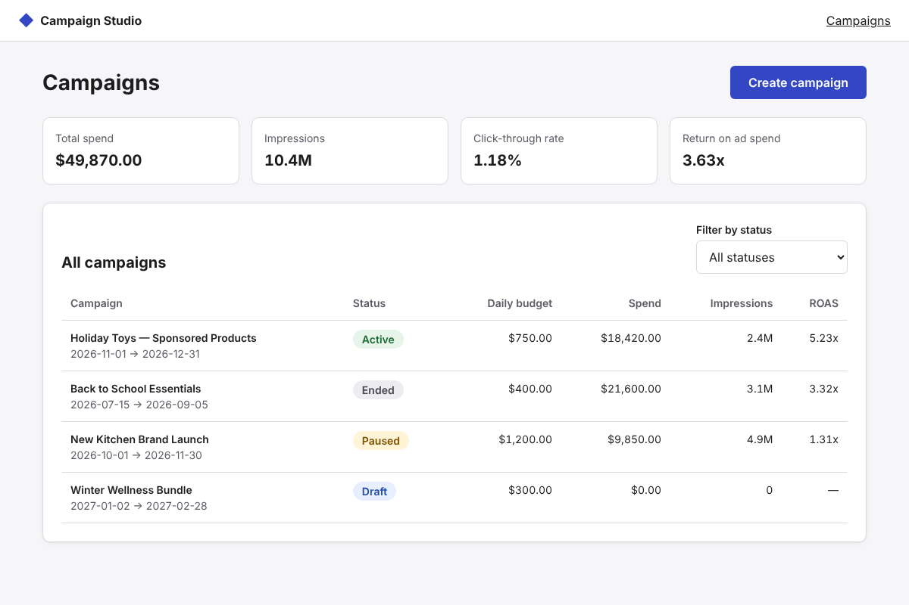

# Campaign Studio

A self-service ad campaign manager: advertisers review campaign performance and create new
campaigns without needing an account manager. Built with **Next.js (App Router)**, **React 19**,
and **TypeScript**, on top of a small, accessible in-house component library.



## What this project demonstrates

| Area | Where to look |
|---|---|
| **Next.js architecture**: server components, client components, route handlers | `src/app/` |
| **Design system and component library**: tokens, typed reusable primitives, dark mode | `src/app/globals.css`, `src/components/ui/` |
| **Accessibility (WCAG 2.1 AA)**: labeled fields, `aria-describedby` errors, focus-managed error summary, skip link, live regions, keyboard support | `src/components/ui/TextField.tsx`, `src/components/campaigns/CampaignForm.tsx` |
| **Testing**: Jest + React Testing Library for units and components, jest-axe for component a11y, Playwright for end-to-end flows and page-level axe scans | `src/**/__tests__/`, `e2e/` |
| **Shared validation**: one rule set enforced by the form (client) and the API (server) | `src/lib/validation.ts` |
| **Observability**: structured event logging, error boundary reporting, Core Web Vitals, request timing, health check | `src/lib/monitoring.ts`, `src/app/error.tsx`, `src/components/WebVitals.tsx` |
| **On-call practices**: signals, alert thresholds, triage steps, and a real incident write-up | `docs/ON_CALL.md` |
| **CI/CD**: type check, tests with coverage, build, and e2e on every push and pull request | `.github/workflows/ci.yml` |
| **Design handoff**: Figma file mirroring the code tokens and components | `docs/FIGMA.md` |

## Getting started

```bash
npm install
npm run dev          # http://localhost:3000
```

## Testing

```bash
npm test             # Jest: unit, component, and accessibility tests
npx playwright install chromium
npm run test:e2e     # Playwright: end-to-end flows + axe WCAG scans (builds and starts the app)
npm run ci           # type check + unit tests + production build
```

## Architecture notes

- **Data layer.** `src/lib/store.ts` is an in-memory stand-in for a campaign service. The UI only
  talks to `/api/campaigns`, so replacing the store with a real REST backend doesn't touch components.
- **Server vs. client components.** The campaign list page renders on the server; only the parts that
  need interactivity (the status filter and the form) are client components.
- **Validation.** `validateCampaign()` runs in the browser for instant feedback and again in the API
  route, so a bad request can't slip past the server.
- **Errors.** Validation errors return `422` with field-level messages that the form renders inline.
  Unexpected failures are reported through `monitoring.ts` and shown as a friendly message.

## Roadmap

- Campaign detail page with daily performance chart
- Edit, pause, and resume campaigns
- Product targeting search with debounced queries
- Pagination and sorting for large accounts
